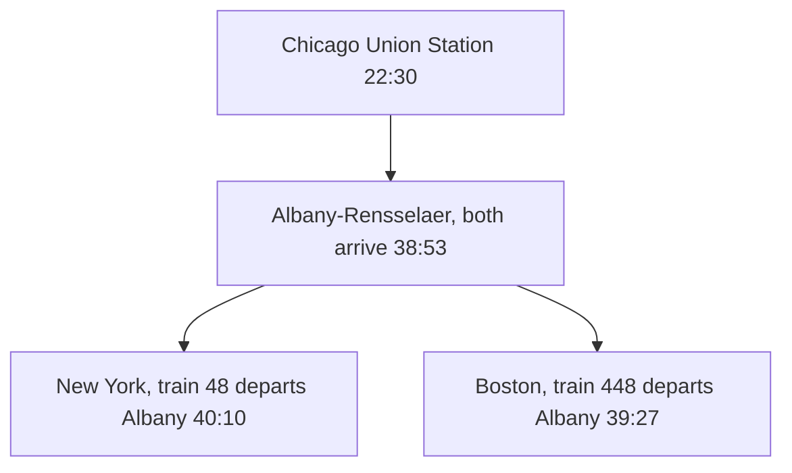

# Where Darwin does not fit GTFS

Darwin fields that GTFS or GTFS-Realtime cannot say cleanly. Each one was checked against the current spec and against issues and pull requests on [google/transit](https://github.com/google/transit). Nothing was filed there.

The encodings this feed will use are decided in `docs/superpowers/specs/2026-11-20-darwin-gtfs-rt-design.md`. This note is the evidence, not a second design.

GTFS identifiers are quoted as published. In particular the realtime enum is `CANCELED`.

## 1. Splits and joins

**Darwin.** From schema version 11 the Push Port sends association elements separately from schedules (Rail Delivery Group P75301004, Issue 27, §3.3.2). A category is Join, Divide, Link, or Next. Each association names a TIPLOC, a main service, an associated service, and flags for cancelled and deleted. For Join and Divide the main service continues through the TIPLOC and the associated service starts or ends there. Link is a passenger change of trains. Next means the main service's stock forms the associated service. From version 11 a divide can also say the train is in reverse formation, and that stock detached from the front (§3.3.4).

**GTFS today.** `trips.block_id` is sequential trips of one vehicle on shared service days. The spec tells producers to use `transfer_type` 4 for an in-seat transfer instead ([reference](https://github.com/google/transit/blob/master/gtfs/spec/en/reference.md)). `transfer_type` 4 and 5, added by [pull 303](https://github.com/google/transit/pull/303), link trips end to end: the last stop of `from_trip_id` should be geographically close to the first stop of `to_trip_id`, and the last arrival should fall just before the first departure. The same section says the vehicle may be coupled to or uncoupled from other vehicles, and that 1-to-n links are allowed, but the geometry it describes is still end to end. [Pull 44](https://github.com/google/transit/pull/44) fixed `block_id` to the operational "same vehicle" meaning and moved the in-seat meaning out of it. GTFS-Realtime has no association message at all: a TripUpdate cannot say that two trips are coupled right now, or that the couple was cancelled.

**Already filed.** [Issue 548](https://github.com/google/transit/issues/548) asks to relax the end-to-end rule so a portion can attach or detach in the middle of another trip. The example is National Rail: London Bridge to Caterham, with a portion taken off at Purley for Tattenham Corner. The discussion's workaround is three trips (London Bridge–Purley, Purley–Caterham, Purley–Tattenham Corner) joined with `transfer_type` 4. That workaround rewrites the trip ids. Darwin updates a RID, and a RID is the whole schedule, so splitting it would orphan the TripUpdate.

**Lake Shore Limited.** The same shape exists on Amtrak, and the published static feed does not model it either. `https://content.amtrak.com/content/gtfs/GTFS.zip` fetched on 20 November 2026 (`feed_version` `20261120`, `feed_start_date` `20261121`) has route `81`, long name Lake Shore Limited. `trips.txt` has no `block_id` column. The zip has no `transfers.txt`.

On `service_id` `112770737319` the eastbound pair is two full trips that share Chicago to Albany-Rensselaer and then diverge:

| Train | `trip_id` | From | Albany-Rensselaer | To |
| --- | --- | --- | --- | --- |
| 448 | 318512 | Chicago Union Station 22:30 | seq 16, arrive 38:53, depart 39:27 | Boston South Station 44:32 |
| 48 | 313112 | Chicago Union Station 22:30 | seq 16, arrive 38:53, depart 40:10 | Moynihan Train Hall 42:42 |

The westbound pair combines. 449 (`trip_id` 318517) leaves Boston at 12:50, calls Albany-Rensselaer 18:10–19:05, and reaches Chicago at 35:12. 49 (`trip_id` 313116) leaves Moynihan at 15:40, calls Albany-Rensselaer 18:20–19:05, and reaches Chicago at 35:12. They depart Albany together and arrive at Chicago together. Times after midnight are GTFS extended hours.

A code search of `sohampatwardhan/Amtrak-GTFS-RT` on the default branch found no uses of `block_id`, association, split, or join. That service publishes Amtrak's static zip, plus platform stops when tracks are on, and matches realtime trains onto those trip ids. It does not add a link between 48 and 448.

**What a single proposal can cite.** One static-and-realtime association, with a category and a cancelled flag, covers both. Darwin is the case where the producer already emits Join, Divide, Link, Next, cancellation, and deletion. The Lake Shore Limited is the case where the timetable already published by the operator is two overlapping trips with no `block_id` and no transfer, so a consumer cannot tell that 48 and 448 are one train west of Albany. The three-trip workaround in issue 548 does not fit either producer: Darwin's realtime key is the unsplit RID, and Amtrak's realtime key is the train number of the unsplit trip. `transfer_type` 4 cannot describe Link, which is not the same vehicle.

**Feature request.** Worth a new google/transit proposal. Issue 548 should be linked, not treated as already solving it. Do not file it as part of this repository's work.

## 2. Delay and cancellation reasons

**Darwin.** A schedule carries a cancellation reason, and from schema version 17 a location can override it (P75301004 §3.3.1). A TS update carries a late-running reason from version 17 (§3.3.4). The wording comes from the timetable reference data.

**GTFS today.** A TripUpdate can be `CANCELED` and a StopTimeUpdate can be `SKIPPED`, and either can carry a delay in seconds. Neither message has a reason. Alert `cause` is a closed enum. `cause_detail`, added as an experimental field by [pull 332](https://github.com/google/transit/pull/332), is free text on the alert, and only when `cause` is set too. [Issue 469](https://github.com/google/transit/issues/469) and [pull 482](https://github.com/google/transit/pull/482) say a multi-day cancellation should be a `CANCELED` TripUpdate plus a `NO_SERVICE` alert the rider can read. That is a display split, not a code for "this stop was cancelled because of a points failure".

**Encoding.** TripUpdates carry the cancellation or the minutes. Alerts carry the reference-data sentence in `header_text` and `cause_detail`, with `cause` left as `UNKNOWN_CAUSE` unless a reviewed map says otherwise. A Darwin reason code is not forced into `TECHNICAL_PROBLEM`.

**Feature request.** Worth a new proposal for a reason on the TripUpdate and on the StopTimeUpdate, so a consumer can show "cancelled, signal failure" without inventing an alert for every late train. Pull 332 is the alert-scoped cousin and should be cited. Do not file it here.

## 3. Platform confirmed or suppressed

**Darwin.** From schema version 11 a platform on a TS location has a source and a confirmation status. `platsup` true means the platform must not be shown to the public. CIS suppression and location suppression both force `platsup` true, so a client only needs to read `platsup` (P75301004 §3.3.4.1).

**GTFS today.** `StopTimeProperties.assigned_stop_id`, added by [pull 219](https://github.com/google/transit/pull/219), names a stop, usually a platform in the same station. It is still marked experimental. It has two states: assigned, or absent. It cannot say "expected, not yet confirmed" or "known, but suppressed".

**Encoding.** A confirmed, non-suppressed platform becomes a child stop and `assigned_stop_id`. Anything else is omitted. The expected-but-unconfirmed value is dropped rather than shown as fact.

**Feature request.** Worth a small proposal: a status on the assignment, with values for confirmed, provisional, and suppressed. Pull 219 is the field it would extend. Do not file it here.

## 4. Delayed, with no estimate

**Darwin.** A TS location can carry an unknown-delay indication, literally `delayed`, with no expected time (P75301004 §3.3.4). That is a positive statement: the train is late and Darwin does not have a minute count. It is not the same as a missing report.

**GTFS today.** A StopTimeUpdate with a time or a delay is a number. `StopTimeUpdate.schedule_relationship = NO_DATA` means no StopTimeEvents are given for this stop, and if that is the last update then the rest of the trip is unspecified too ([proto](https://github.com/google/transit/blob/master/gtfs-realtime/proto/gtfs-realtime.proto)). Consumers treat `NO_DATA` as "fall back to the timetable", which hides the lateness. [Issue 144](https://github.com/google/transit/issues/144) is about propagating a delay that was sent as a time. It is not this case. A search of google/transit issues for a `DELAYED` schedule relationship, or for "late but no estimate", found no proposal.

**Encoding.** The affected stop is `NO_DATA` with no arrival and no departure. Later stops that have their own public forecasts keep them. No minute count is invented, and no alert is raised just because the flag is set.

**Feature request.** Worth a new proposal. The missing value is "this stop is known to be late, and the estimate is unknown", which must not wipe later forecasts and must not look like the timetable is being met. Do not file it here.

## 5. Formations and loading

**Darwin.** From schema version 15 a formation lists coaches in travel order, with a coach id and an optional class such as First, Standard, or Mixed (P75301004 §3.3.3). `formationLoading` gives a 0–100 value per coach at one TIPLOC. It does not ripple to the next stop. An empty loading element clears it. `avgLoading` on the schedule is a long-run average, not the live load (§3.3.5). A toilet element is `Unknown`, `InService`, or `NotInService`. Train length can disagree with the formation, because both are supplied from outside Darwin. Reverse formation and detach-from-front are association facts, covered in section 1.

**GTFS today.** `VehiclePosition.multi_carriage_details`, from [pull 237](https://github.com/google/transit/pull/237), has `id`, `label`, `carriage_sequence` in the direction of travel, `occupancy_status`, and `occupancy_percentage`. It is still experimental. It has no ticket class, no toilet, and no catering. [Issue 614](https://github.com/google/transit/issues/614) is about which carriage meets which platform exit. That is a different question.

**Encoding.** Coach id, order in the direction of travel, and the live 0–100 loading are written to `multi_carriage_details`. Reverse formation is the reversed sequence, not a separate flag. Class, toilet state, `avgLoading`, and a bare train length are not copied. Occupancy enums such as `FEW_SEATS_AVAILABLE` are not derived from the percentage: that would replace Darwin's number with a band Darwin did not send.

**Feature request.** Not as one ticket. Order and loading already have a field. A proposal is only worth filing for coach class and on-board facilities, and only if the author shows that `label` free text is not enough. Detach-from-front belongs on the association proposal in section 1. Do not file either here.

## 6. Passing points

**Darwin.** Schedules include passing points as well as calls. From schema version 9, TS messages carry expected and actual passing times (P75301004 §3.3.4). Those times are how Darwin forecasts the next call. They are not places a passenger boards.

**GTFS today.** `stop_times.txt` is a list of stops. The best-practice text says internal timing points where nobody can board should use `pickup_type` 1 and `drop_off_type` 1. [Issue 560](https://github.com/google/transit/issues/560) records that feeds which do this still get passing points drawn as stops in apps, and asks where the line sits between passenger information and operational detail. `cif2gtfs` drops passing points by default ([cif2gtfs](https://planarnetwork.github.io/gb-transit/tools/cif2gtfs/)).

**Encoding.** Passing points are not rows in `stop_times.txt`. Their times stay inside the store and are not a VehiclePosition and not a TripUpdate. A passenger call is the only stop a TripUpdate names.

**Feature request.** No. Issue 560 is the existing discussion. A new issue that only repeats "please do not list passing points" would be a duplicate. The feed follows the cif2gtfs default and omits them.

## 7. Peak and off-peak restrictions

**The feed.** RDG fares, RSPS5045 §4.18.8. A `TR` record bans or qualifies a ticket between `TIME_FROM` and `TIME_TO`. `ARR_DEP_VIA` is `D` (departures from `LOCATION`), `A` (arrivals at `LOCATION`), or `V` (changing at `LOCATION`). `LOCATION` is a CRS, or spaces when the ban is not tied to a station. `MIN_FARE_FLAG` `Y` means the ticket survives but a minimum fare applies. Published examples include restriction PU: not valid on trains timed to depart London Marylebone or Paddington, or Reading, in morning and evening windows, and not valid via London on trains timed to arrive at a London terminal before 10:00 ([National Rail, restriction PU](https://www.nationalrail.co.uk/ticket-types/validity/pu/)).

**Fares v2 today.** `timeframes.txt` and `fare_leg_rules.from_timeframe_group_id` / `to_timeframe_group_id`, added by [pull 357](https://github.com/google/transit/pull/357), test the start or the end of the fare leg. The start is when the rider boards. They do not test a departure from a station in the middle of the leg. A search found no proposal for "not valid on trains departing station Y before time X" where Y is not the boarding stop.

**Encoding.** Blank `LOCATION` with `D` or `A` becomes the complement window on the leg start or leg end. Anything with a CRS, or `ARR_DEP_VIA` `V`, is not encoded as a timeframe. `MIN_FARE_FLAG` `Y` is not encoded as a price.

**Feature request.** Yes. A fare rule that can name a station on the journey, a direction (depart, arrive, or change), and a banned clock window. Pull 357 is the leg-end cousin. Do not file it here.

## 8. Easements and route restrictions

**The feed.** The route file lists locations a route includes or excludes (RSPS5045, routes file). The Routeing Guide adds easements: a positive easement allows a journey the guide would refuse, a negative one forbids a journey the guide would allow ([easement text](https://iblocks-rg-publication.s3.eu-west-1.amazonaws.com/easement_text.pdf)). Restriction PU's notes include a one-train easement from Didcot Parkway.

**Fares v2 today.** `fare_leg_rules` matches origin area, destination area, and network. It has no via list and no avoid list. `fare_leg_join_rules` can glue two legs into one effective leg. [Issue 555](https://github.com/google/transit/issues/555) is about a fare that requires a transfer at a station. It is not an easement and not "not via London". No proposal was found for a route-restriction or easement record.

**Encoding.** Origin and destination areas are written. Via, avoid, and easement text stay in the passenger-readable restriction note. They are not turned into a fake `network_id`.

**Feature request.** Yes, as one proposal covering a via/avoid constraint and a dated exception for a single train. Issue 555 should be linked, not treated as the same request. Do not file it here.

## 9. Railcard eligibility beyond a category name

**The feed.** Some railcard prices are published as their own fare. Others are a discount, a minimum fare, or a rule such as two named people travelling together.

**Fares v2 today.** `rider_categories.txt`, from [pull 511](https://github.com/google/transit/pull/511), names a category and can mark a default. It has no minimum group size and no "must be accompanied" flag.

**Encoding.** A railcard with its own published amount is a `rider_category` on that `fare_product`. Accompanied and group rules are not given a category.

**Feature request.** Yes, for a group-size or accompanied condition on a rider category. Pull 511 names the category and does not say who must travel with them. Do not file it here.

## Summary

| Gap | Existing google/transit thread | New proposal is warranted |
| --- | --- | --- |
| Splits and joins, including the Lake Shore Limited | [Issue 548](https://github.com/google/transit/issues/548), [pull 303](https://github.com/google/transit/pull/303), [pull 44](https://github.com/google/transit/pull/44) | Yes. 548 does not cover an unsplit realtime id, Link, cancellation, or two overlapping published trips. |
| Per-trip and per-stop reasons | [Pull 332](https://github.com/google/transit/pull/332), [issue 469](https://github.com/google/transit/issues/469), [pull 482](https://github.com/google/transit/pull/482) | Yes. Reasons live on the alert, not on the trip update. |
| Platform confirmed or suppressed | [Pull 219](https://github.com/google/transit/pull/219) | Yes. The assignment has no status. |
| Delayed with no estimate | [Issue 144](https://github.com/google/transit/issues/144) is a different question. No matching proposal found. | Yes. |
| Formation order and live loading | [Pull 237](https://github.com/google/transit/pull/237) | No. The fields exist. |
| Coach class and toilet | [Issue 614](https://github.com/google/transit/issues/614) is about doors and exits | Only for class and facilities, and only if free-text `label` is shown to be insufficient. |
| Passing points | [Issue 560](https://github.com/google/transit/issues/560) | No. |
| Station-specific and change-at time bans | [Pull 357](https://github.com/google/transit/pull/357) covers the boarding stop and the alighting stop only | Yes. |
| Easements and via/avoid routes | [Issue 555](https://github.com/google/transit/issues/555) is a required transfer, not a route ban | Yes. |
| Railcard group and accompanied rules | [Pull 511](https://github.com/google/transit/pull/511) | Yes. A category name is not an eligibility rule. |
