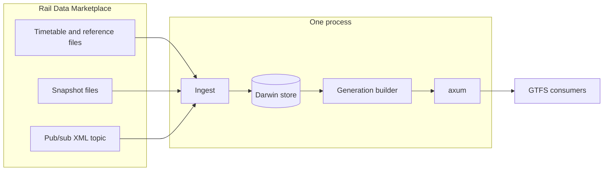
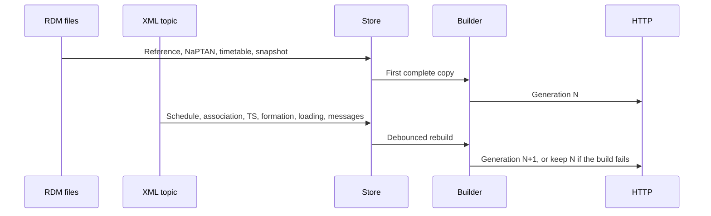

# Darwin to GTFS-Realtime

Date: 2026-11-20

This is the design for [NationalRailGB-GTFS-RT](https://github.com/sohampatwardhan/NationalRailGB-GTFS-RT). It is a specification only. No service code is in the repository yet. The implementation plan is `docs/superpowers/plans/2026-11-20-darwin-gtfs-rt.md`. Gaps between Darwin and GTFS are `docs/gtfs-gaps.md`.

Documentation in this repository uses British English. GTFS identifiers stay as published, including the enum value `CANCELED`. Print, PDF, and any documentation page-size setting use A4.

## Problem

Apps that already consume GTFS-Realtime need Great Britain's national rail realtime: schedules, forecasts, platforms, cancellations, and associations from the Darwin Push Port. They also need a static GTFS feed whose trip and stop ids are the ones the realtime feed uses. National Rail does not publish that pair.

The owner's [Amtrak-GTFS-RT](https://github.com/sohampatwardhan/Amtrak-GTFS-RT) is the model for the stack and the way the feed is served: one Rust process, one container on GHCR for amd64 and arm64, a Raspberry Pi as the deploy target, a generation manifest, a peer allowlist, and a MobilityData validator in CI. The sources, the licence, and several GTFS mappings have to differ. Those differences are recorded below.

## Approaches

Three ways to produce the pair were considered.

1. **Poll the live departure board (OpenLDBWS or the JSON LDB).** Rejected. It is a per-station request API, the NRE usage charge starts above 5 million enquiries per railway period, and it does not carry the national association, formation, and schedule-update stream. Wrappers such as `nre-darwin-py` and Darwin.Net stop at the board.
2. **Build static GTFS from the CIF/DTD timetable, then attach realtime later.** Rejected as the published feed. [planarnetwork/gb-transit](https://github.com/planarnetwork/gb-transit) and [catenarytransit/nationalrail-gtfs](https://github.com/catenarytransit/nationalrail-gtfs) already do the static half. Their trip ids are CIF identities, not Darwin RIDs, so a Push Port TripUpdate would not join. `nationalrail-gtfs` has no `LICENSE` file; do not copy it.
3. **Hold a copy of the Darwin database and publish GTFS from that copy.** Chosen. The Darwin timetable, reference data, and snapshots are the static base. The Push Port is the update stream. One process publishes one generation: a static zip plus TripUpdates, VehiclePositions, and Alerts. This is the same shape as Amtrak-GTFS-RT's combined process, with a different source.

## Licensing and access

Two licence layers apply. The code in this repository is AGPL-3.0-only. The Darwin data is not.

National Rail's developer page lists the Darwin Push Port, the Darwin timetable, and the LDB as open feeds under the NRE Open Government Licence, and points registration at the Rail Data Marketplace ([Darwin data feeds](https://www.nationalrail.co.uk/developers/darwin-data-feeds/)).

The NRE licence text on the legacy portal ([terms](https://opendata.nationalrail.co.uk/terms)) grants a worldwide, royalty-free, non-exclusive licence to copy, publish, distribute, and transmit the information, to adapt the format provided the content is not amended, and to include it in an end-user product. It requires attribution to NRE, forecasts in an end-user product that stay consistent with Darwin, and time-bound data displayed as Darwin directs. The access right is personal and may not be assigned. High-volume charges do not apply to push feeds. The [usage-charging document](https://assets.nationalrail.co.uk/e8xgegruud3g/1FMZaTCkitl5TXLHyEAEvw/a493521c9d9a4e90c012bfce5b16363a/Usage_Charging_Document_v06-01.pdf) (v06-01) says the same: push feeds have no free-usage cap and no per-enquiry charge; the 5 million enquiry threshold and the 5,000 enquiry/hour cap apply to the Darwin web services only.

The Rail Data Marketplace is the current catalogue. Timetable files, reference data, and snapshots are separate file products from the pub/sub stream ([Darwin Publish and Subscribe via the RDM](https://www.rspaccreditation.org/downloadPublic.php?did=UDIHmUXqaFxqhsxmKpbrujGOzo2VC5GI9nmsT0IErZmBy0ZRvM)). The snapshot product is described as free to registered users, globally usable, retainable, attributed to National Rail, and not to be resold as-is or substantially unmodified ([snapshot product](https://raildata.org.uk/dashboard/dataProduct/P-8b01d5cf-2dd4-48b4-bb98-dc6d3520baf9/discussion)). A GTFS-Realtime feed is a format adaptation of the kind the NRE terms allow, not a resale of the XML. The STOMP password and the file credentials stay on the operator's machine.

Consequences for the feed:

- Public forecast times are copied from Darwin. They are not smoothed, rounded differently, or replaced with a model.
- Working forecasts, which the Push Port spec says are operational and not for public display, are not published.
- Raw Push Port XML, snapshots, and credentials are never served and never logged.
- `feed_info.txt` names National Rail as the source of the times and links to the National Rail developer page.
- Deactivated, deleted, and suppressed services are not published. The Push Port spec (P75301004, Issue 27, §3.3.1) says a deactivated service should not be published to the public.
- Until the owner confirms that a public relay is acceptable, the HTTP API uses the Amtrak peer allowlist. Loopback only, unless `NR_ALLOWED_PEER_IPS` lists peers. See the open question on the tracking issue.

NaPTAN is a separate DfT dataset, used only for coordinates. It is not Darwin data.

## Prior art

No open-source Darwin Push Port to GTFS-Realtime converter was found. Searches covered GitHub projects that mention the Push Port, GTFS-Realtime, and National Rail together, the Open Rail Data examples, and the RDM sample client.

| Project | What it does | How this project differs |
| --- | --- | --- |
| [planarnetwork/gb-transit](https://github.com/planarnetwork/gb-transit) | CIF/DTD to static GTFS, nightly, NaPTAN coordinates, passing points dropped by default (`cif2gtfs --remove-passing-points`) | No Push Port and no GTFS-Realtime. Trip ids are CIF identities. |
| [catenarytransit/nationalrail-gtfs](https://github.com/catenarytransit/nationalrail-gtfs) | Rust reader of the legacy NRDP CIF timetable. Writes static GTFS and a non-standard `associations.txt`. No licence file, no README. | No Push Port, no protobuf, no server. Different id space. Do not copy the code. |
| [raildatamarketplace/rdm-darwin-kafka-client](https://github.com/raildatamarketplace/rdm-darwin-kafka-client) | Sample consumer for the RDM Kafka topics | Transport only. |
| Open Rail Data STOMP examples, `nre-darwin-py`, Darwin.Net, arrivals-kmp | STOMP clients or LDB departure boards | They do not emit GTFS-Realtime. |

The interface this design targets is the RDM Darwin pub/sub XML topic, plus the Darwin timetable files, the reference data, and the snapshot files. The legacy STOMP broker on `opendata.nationalrail.co.uk` is not an implementation target. The Push Port message vocabulary is the same on both transports and is specified in Rail Delivery Group document P75301004, Issue 27, and summarised on the [Open Rail Data wiki](https://wiki.openraildata.com/index.php/Darwin:Push_Port).

## What is in the feed

One generation is one static GTFS zip and three protobuf products, plus one sidecar for associations. Consumers start at `GET /v1/feed-set.json` and then fetch the immutable URLs in that manifest.

| Product | Darwin source | GTFS target |
| --- | --- | --- |
| Static zip | Timetable schedules for passenger services, reference names, NaPTAN coordinates, confirmed platforms | `agency.txt`, `routes.txt`, `trips.txt`, `stop_times.txt`, `calendar_dates.txt`, `stops.txt`, `feed_info.txt`, and `transfers.txt` only for Next and Link |
| TripUpdates | TS forecasts and actuals, cancellations, platforms | One entity per published RID |
| VehiclePositions | Last reported public location, formation, loading | One entity per RID that has a reported location |
| Alerts | Cancellation reasons, late-running reasons, station messages, train alerts with passenger text | One entity per message |
| `associations.json` | Association elements | Sidecar, not inside the zip |

Out of the feed: empty coaching stock and any schedule with `isPassengerService` false, buses and ferries, working forecasts, operational alarms, passing points, unconfirmed platforms, suppressed platforms, deactivated and deleted schedules, and the raw XML.

## Architecture

One container. No browser and no second process. Darwin is an authenticated push, unlike Amtrak's map feed, so the Chromium worker in Amtrak-GTFS-RT is not copied.

| Piece | Responsibility |
| --- | --- |
| `Config` | Environment via `from_map`. Secrets never appear in `Debug` or logs. |
| Ingest | Download timetable, reference, and snapshot files. Consume the XML topic. Apply messages to the store. On a gap longer than the broker retains, resync from a snapshot. |
| `DarwinStore` | In-memory copy of activated passenger schedules, associations, forecasts, platforms, formations, loading, and passenger messages. |
| `StopCatalog` | TIPLOC, CRS, name, and NaPTAN coordinate. Built from reference data and NaPTAN. |
| Generation builder | Static zip, three protobuf feeds, associations sidecar. Pure function of the store, the catalogue, and a clock. |
| HTTP | Serve the last complete generation from memory. Never wait on Kafka or object storage. |

Startup order: reference and NaPTAN, then the timetable, then a snapshot, then the live topic. The first generation is published only when all three of reference, timetable, and snapshot have been applied. A later failure leaves that generation in place.

Rebuilds are debounced by 5 seconds and skipped when the store has not changed. `/readyz` is 200 only while the served generation is younger than 300 seconds.

## Identity

These choices are deliberate. Changing them later breaks every consumer.

- `trip_id` is the Darwin RID, verbatim. `TripDescriptor.start_date` is the scheduled start date, `YYYYMMDD`.
- `service_id` is that same date. Service runs as `calendar_dates.txt` rows with `exception_type` 1. There is no weekly `calendar.txt`: a Darwin timetable is a short activated window, not a permanent rule.
- `trip_short_name` is the retail service id (`rsid`) when Darwin sends one, otherwise the headcode.
- `trip_headsign` is the public destination name.
- One `agency.txt` row per TOC code in the reference data. `agency_timezone` is `Europe/London`. `agency_url` is `https://www.nationalrail.co.uk`.
- `route_id` is the TOC code. `route_type` is 2. `route_long_name` is the TOC name. A national feed with one route per origin and destination pair is unstable and is not used.
- `feed_info.feed_version` is the timetable file id. When confirmed platform stops are added, the version gains `+plat.` and the first 8 hex digits of the platform table, and the realtime headers use that same version.

## Stops

`stop_id` for a scheduled calling point is the TIPLOC. `stop_code` is the CRS when the reference data maps it. Where several TIPLOCs share a CRS, a parent stop `crs:{CRS}` has `location_type` 1 and the TIPLOC stops are its children.

Coordinates come from NaPTAN, matched on CRS. A passenger TIPLOC with a CRS and no NaPTAN coordinate fails the static build. The previous generation keeps being served. Coordinates are not invented, and `0,0` is not written. Passing and operational TIPLOCs are not stops.

A platform stop `{tiploc}:plat:{label}` exists only for a platform Darwin has marked confirmed and not suppressed. `platform_code` is Darwin's label. `StopTimeUpdate.stop_time_properties.assigned_stop_id` points at it, and `stop_sequence` is always set in that case. An unconfirmed platform is not assigned. A suppressed platform (`platsup` true, which also covers CIS suppression and location suppression) is not assigned and is not a stop. This loses the "expected but not confirmed" state; see `docs/gtfs-gaps.md`.

## TripUpdates

For each published RID, one TripUpdate.

- A public forecast or actual arrival or departure is copied onto that stop's `StopTimeEvent`. Actual times already in the past use uncertainty 0. The time is Darwin's public time, not the working forecast.
- A cancelled service is `TripDescriptor.schedule_relationship = CANCELED`. Stop-level cancellations on a running service are `StopTimeUpdate.schedule_relationship = SKIPPED`.
- A location Darwin marks delayed, with no public estimate, gets `StopTimeUpdate.schedule_relationship = NO_DATA` and no arrival or departure. Other stops on the trip keep their own forecasts. No delay is invented. `NO_DATA` means "no realtime information", which is not what Darwin means; the gap is documented, and the encoding is the least wrong value that does not fabricate a minute count.
- A stop with neither a forecast, an actual, nor a delayed flag is omitted, so the static time stands.

## Associations

Darwin categories, from P75301004 §3.3.2: Join, Divide, Link, Next. Join and Divide: the main service continues through the TIPLOC and the associated service terminates or starts there. Link: passengers change trains. Next: the main service's stock forms the associated service.

`block_id` is the wrong tool for Join and Divide. The GTFS spec defines it as sequential trips of one vehicle, and says in-seat transfers belong in `transfer_type` 4. Two portions that run coupled over a shared section are not a sequence.

`transfer_type` 4 and 5 require the trips to meet end to end. The spec says the last stop of `from_trip_id` should be next to the first stop of `to_trip_id` ([reference](https://github.com/google/transit/blob/master/gtfs/spec/en/reference.md), [pull 303](https://github.com/google/transit/pull/303)). A Darwin divide, and Amtrak's Lake Shore Limited, share a middle section. Issue [548](https://github.com/google/transit/issues/548) asks to relax that for mid-trip attach and detach and suggests splitting into three trips. Splitting a RID would make the TripUpdate miss the service Darwin updates. This feed does not split RIDs.

Encoding that is published:

| Category | `transfers.txt` | Sidecar |
| --- | --- | --- |
| Next, and the TIPLOC is the last public stop of the main trip and the first public stop of the associated trip | `transfer_type` 5 | yes |
| Next that does not meet end to end | none | yes |
| Link | `transfer_type` 1 at that stop, both trip ids set | yes |
| Join, Divide | none | yes |
| Cancelled or deleted | omitted | omitted |

No `block_id` is written. The sidecar is `associations.json` beside the zip, schema `national-rail-associations/v1`, with `category`, `main_trip_id`, `associated_trip_id`, and `stop_id`. It is not a file inside the zip, so the GTFS validator does not see an unknown table. Detail and the Lake Shore Limited evidence are in `docs/gtfs-gaps.md`.

## VehiclePositions

Darwin does not provide a carriage latitude. No position is invented. A VehiclePosition is emitted only when a TS update has reported a public location for the RID. `current_stop_sequence` and `stop_id` are set. `current_status` is `STOPPED_AT` when the last report is an arrival with no later departure, and `IN_TRANSIT_TO` the next public stop otherwise. `vehicle.id` is the RID. `vehicle.label` is `trip_short_name`.

When a formation is present, `multi_carriage_details` lists every coach. `label` is the coach id. `carriage_sequence` is the order in the current direction of travel, which is how a reverse formation at a divide is expressed. `occupancy_percentage` is Darwin's 0–100 loading for that coach at that location. Loading does not ripple: a later stop keeps the last explicit value only in this process's reading of the formation, and a cleared formation publishes no percentages. Coach class, toilet state, and "detached from the front" have no field; they are gaps. `avgLoading` is a long-run average, not a realtime load, and is not copied into `occupancy_percentage`.

## Alerts

Alerts are rider-facing text Darwin has already written. They are not a second copy of every delay.

- A cancelled trip produces one alert. `effect` is `NO_SERVICE`. `informed_entity` is that trip and `start_date`. `header_text` and `cause_detail` are the reason wording from the reference data. `cause` stays `UNKNOWN_CAUSE`. A reviewed map from reason codes onto the GTFS cause enum is a later change, not part of the first build. Unknown wording is not forced into `TECHNICAL_PROBLEM`.
- A late-running reason produces one alert with `effect` `SIGNIFICANT_DELAYS` and the same text fields. The minute count stays in the TripUpdate.
- A station message or train alert that contains passenger text produces an alert with `effect` `OTHER_EFFECT` and that text as `header_text`. Operational alarms are dropped.
- A delayed flag with no estimate does not produce an alert.

## HTTP

Same contract as Amtrak-GTFS-RT, with `NR_` environment variables and an associations sidecar.

| Path | Access | Body |
| --- | --- | --- |
| `/livez` | public | Process is up |
| `/readyz` | peer | 200 only when the generation is under 300 seconds old |
| `/v1/feed-set.json` | peer | Generation id, timestamp, `feed_version`, entity counts, artefact URLs |
| `/v1/generations/{id}/static.zip` | peer | Static GTFS for that generation |
| `/v1/generations/{id}/trip-updates.pb` | peer | Protobuf |
| `/v1/generations/{id}/vehicle-positions.pb` | peer | Protobuf |
| `/v1/generations/{id}/alerts.pb` | peer | Protobuf |
| `/v1/generations/{id}/associations.json` | peer | Sidecar |

Responses carry `ETag` and `Last-Modified` and answer `If-None-Match` / `If-Modified-Since` with 304. `Forwarded` and `X-Forwarded-For` are ignored. An empty allowlist is loopback only. A non-loopback bind with no allowlist refuses to start. The container default allowlist is `gateway`, resolved to the container's IPv4 default gateway. 403 is an unauthorised peer, 404 is an unknown generation, 503 is no fresh generation.

There is no `/trip-updates.pb`, `/vehicle-positions.pb`, `/alerts.pb`, or `/static.zip` at the root.

## Errors

A bad message is logged with its type and RID and skipped. The store is not cleared. A failed timetable or snapshot download keeps the last good generation. A static build or validator error keeps the last good generation. A missing platform, a broken association, or a missing reason code never drops TripUpdates. Kafka reconnects with backoff. Credentials, URLs that contain them, and raw XML bodies are not logged.

## Testing

Unit tests are offline. Config is injected with `from_map`. HTTP tests call the axum router with an injected peer and clock. Darwin fixtures are small XML fragments checked into `fixtures/`. A live connection test is `#[ignore]` and is not part of pull-request CI.

The CI fixture builds a tiny store (one trip, one divide, one cancellation, one confirmed platform, one formation) through the real builder. The MobilityData GTFS validator 8.0.1 must report zero errors on the zip. The MobilityData GTFS-Realtime validator must accept the three protobuf files. No Darwin host is called.

## Container and CI

Image `ghcr.io/sohampatwardhan/national-rail-gb-gtfs-rt`, `linux/amd64` and `linux/arm64`. Multi-stage build: `rust:1.96-bookworm` builder, runtime `debian:bookworm-slim` with tini and a JRE 17 for the validator. No Python and no Chromium. Compose publishes `127.0.0.1:8090:8080` and is enough to run on the Pi from the GHCR image without a checkout.

CI matches the Amtrak shape where it still applies: `cargo fmt`, tests, an offline validator fixture, native image builds on amd64 and arm64, and a docs-only skip so a change that touches only `*.md`, `docs/`, or `LICENSE` does not rebuild the image. The skip is per step, not a workflow-level path filter. Dependabot covers Cargo weekly, and GitHub Actions and Docker monthly, with the same grouping and cooldown as Amtrak-GTFS-RT. There is no pip ecosystem.

Release tags `v*.*.*` publish the one image. The release is not part of this design's implementation until the owner asks for a tag.

## What this design does not take from Amtrak

- No `getTrainsData`, no decrypting crate, no browser worker, no Akamai workaround.
- No official upstream static GTFS. This process builds the zip.
- No track-fetcher, Hartford board, or NJ Transit RailData.
- No second image and no `NR_ROLE`.
- The data licence is the NRE / RDM licence, not a free right to republish the XML.

## Open points

Two questions are left for the owner, on the tracking issue, because the wrong answer changes the ingest client or the access control:

1. Whether the served feed may be public, or stays peer-restricted.
2. Which RDM products the owner can subscribe to. This design assumes the XML topic, the timetable files, the reference data, and the snapshots.
